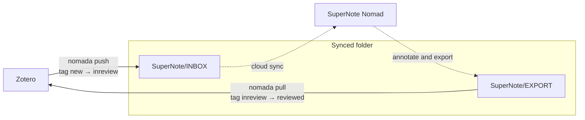

# nomada

`nomada` sends papers from Zotero to a SuperNote Nomad for reading, then
attaches the annotated PDFs back to the original Zotero items. The two sides
exchange files through a folder that both can reach, such as Google Drive or
Insync. Zotero tags record where each paper is. Tested with Zotero 9.

## Workflow



Solid arrows are `nomada` commands. Dashed arrows happen on the Nomad and in
the sync client.

1. Tag a paper `new` in Zotero.
2. `nomada push` copies its PDF to INBOX and changes the tag to `inreview`.
3. Read and annotate the paper on the Nomad, then export it to EXPORT. The
   export keeps the original filename.
4. `nomada pull` attaches the annotated PDF to the Zotero item it came from
   and changes the tag to `reviewed`.

`push` records which Zotero item each filename belongs to, and `pull` uses
that record to match exports to items. `nomada` adds and removes only its own
three tags, and their names are configurable.

## Commands

| command         | what it does |
|-----------------|--------------|
| `nomada config` | ask for settings and save them |
| `nomada push`   | send papers tagged `new` to INBOX |
| `nomada pull`   | attach annotated PDFs from EXPORT to their items |
| `nomada sync`   | `pull`, then `push` |
| `nomada status` | show folders, papers in flight, tag counts, and whether Zotero and the add-on respond |

## Setup

1. Install [uv](https://docs.astral.sh/uv/), then install `nomada` from this
   directory:
   ```sh
   curl -LsSf https://astral.sh/uv/install.sh | sh
   make install
   ```
   This puts a small `nomada` wrapper in `~/.local/bin`. Set `BINDIR` to use
   another directory, as in `make install BINDIR=/usr/local/bin`. The wrapper
   runs the script from this checkout, so keep the checkout where it is, and
   `git pull` updates the installed command. `make uninstall` removes it.

   `nomada` is a single script that declares its own dependencies. uv builds
   and caches its environment on the first run, using the versions pinned in
   `nomada.lock`, and fetches Python 3.11 or newer if needed.

2. In Zotero, enable the local API under Settings → Advanced → *Allow other
   applications on this computer to communicate with Zotero*.

3. Install the [Local Write API](https://github.com/dzackgarza/zotero-local-write-api)
   add-on. Download the latest `.xpi` from its releases page, open Tools →
   Plugins → gear icon → *Install Plugin From File…*, and restart Zotero.

4. Configure and check:
   ```sh
   nomada config
   nomada status
   ```
   `status` exits with an error and marks the problem if a folder is missing
   or Zotero or the add-on doesn't respond.

## Attaching PDFs

`pull` can attach files in two ways. Tagging always goes through the Local
Write API add-on, whichever you choose.

**`localwrite`** is the default. The add-on sends the PDF to Zotero's local
server, so no account or credentials are needed and nothing leaves your
machine. Zotero must be running. The add-on is tested only against Zotero
8.0.1, but it installs on Zotero 9, and `nomada status` confirms it loaded.
Its write endpoints on localhost have no authentication, so any program on
your computer can use them.

**`webapi`** uses the Zotero Web API. It needs sync turned on, your numeric
user ID, and an [API key](https://www.zotero.org/settings/keys) with library
write access. Uploads count against your zotero.org storage quota. It can
attach while Zotero is closed, as long as the item has synced, but tagging
still needs the app.

## Files

| file   | location |
|--------|----------|
| config | `$XDG_CONFIG_HOME/nomada/config.toml`, default `~/.config/nomada/` |
| state  | `$XDG_STATE_HOME/nomada/state.json`, default `~/.local/state/nomada/` |
| log    | `$XDG_STATE_HOME/nomada/nomada.log` |

Only your user can read the config file, because it can hold an API key.

## Behavior

- `push` and `pull` report each paper they can't handle, continue with the
  rest, and exit with status 1. If Zotero, INBOX, or EXPORT is unavailable,
  they stop at once with status 1.
- `pull` handles only papers that `push` sent. It leaves other PDFs in EXPORT,
  such as exported notebooks, in place, and `nomada status` lists them.
- Filenames must be unique among papers in flight, because `pull` matches by
  filename. `push` refuses a paper whose filename is already in flight. A
  Zotero rename pattern based on the citekey avoids collisions.
- Nothing is deleted. `pull` moves the INBOX original to `INBOX/_archived` and
  the export to `EXPORT/_processed`. If a file with the same name is already
  there, it adds a timestamp to the name.
- `pull` skips a PDF modified in the last 60 seconds, since the sync client
  may still be writing it. It reports a PDF without an end-of-file marker as
  possibly truncated.
- `push`, `pull`, and `sync` lock the state file. A second run started while
  one is going exits with status 1.

## Development

`nomada.lock` pins the dependencies. After editing the script's dependency
block, run `uv lock --script nomada`; the installed wrapper refuses to run
while the lock is out of date. Run the tests with `make test`.

## LLM disclosure

I did that work with the help of an AI coding agent. I directed it, reviewed it, and am responsible for the result. The agent assisted me, not the other way around. For that reason my commits credit the agent with an Assisted-by: trailer instead of Co-authored-by:. No LLM provider is an author of these commits or accountable for them.
